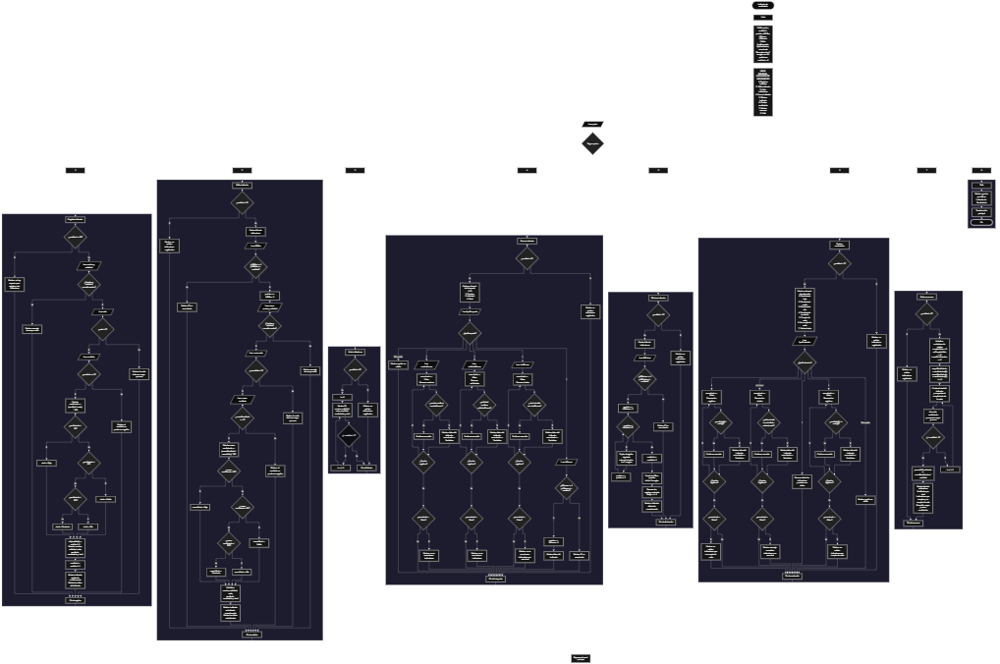

Este proyecto, llamado <b>indicador de rendimiento</b>, fue desarrollado en <b>visual basic .net</b> como un ejercicio práctico para fortalecer la lógica de programación mediante la creación de un sistema de gestión y evaluación de indicadores desde la consola. El programa cuenta con un menú principal de ocho opciones que permite <b>registrar, editar, listar, buscar, eliminar y evaluar indicadores de rendimiento</b>, además de generar un resumen estadístico de los registros almacenados. Cada indicador contiene información como el nombre, la actividad, la meta y el resultado obtenido, utilizando siete arreglos paralelos con una capacidad máxima de <b>20 indicadores durante la ejecución</b>. El sistema calcula automáticamente el porcentaje de rendimiento y clasifica cada indicador en cuatro niveles: <b>bajo, medio, alto y excelente</b>. Durante su desarrollo se aplicaron conceptos fundamentales de programación, como variables, arreglos, estructuras condicionales, ciclos repetitivos, estructuras de selección, operaciones matemáticas y procesos para buscar, modificar, eliminar y organizar registros.

<h2 align="center">⚙️ Funcionamiento del menú principal</h2>

### ➕ Registrar indicador

La opción <b>1) registrar indicador</b> permite almacenar un nuevo indicador de rendimiento. Antes de realizar el registro, el programa comprueba que la cantidad de indicadores almacenados sea menor que la capacidad de los arreglos mediante la condición <b>cantidad &lt; ids.Length</b>. Si existe espacio disponible, solicita el <b>nombre, actividad, meta y resultado</b> del indicador. También comprueba que el nombre y la actividad no estén vacíos, que la meta sea mayor que cero y que el resultado no sea negativo. Después, calcula el porcentaje de rendimiento utilizando la fórmula <b>(resultado / meta) * 100</b> y determina el nivel correspondiente: <b>bajo</b> cuando es menor que 60 %, <b>medio</b> cuando es menor que 80 %, <b>alto</b> cuando es menor que 100 % y <b>excelente</b> cuando alcanza o supera el 100 %. Finalmente, almacena los datos en los siete arreglos, asigna un identificador consecutivo mediante la variable <b>cantidad</b>, incrementa el contador y muestra la información del indicador registrado. Si se alcanza la capacidad máxima, presenta el mensaje <b>"no hay espacio para registrar más indicadores."</b>.

### ✏️ Editar indicador

La opción <b>2) editar indicador</b> permite modificar la información de un indicador registrado. Primero, el programa comprueba si existen indicadores almacenados mediante la variable <b>cantidad</b>. Si no hay registros, muestra el mensaje <b>"no existen indicadores registrados."</b>. En caso contrario, presenta una lista con los datos de todos los indicadores y solicita el ID del registro que se desea editar. Después, verifica que el identificador esté dentro del rango permitido mediante la condición <b>idEditar &gt;= 1 AndAlso idEditar &lt;= cantidad</b>. Si la selección es válida, obtiene la posición correspondiente restando uno al identificador mediante <b>posicion = idEditar - 1</b>. A continuación, solicita el nuevo nombre, actividad, meta y resultado, aplicando las mismas validaciones utilizadas durante el registro. Cuando los datos son correctos, calcula nuevamente el rendimiento y determina su nivel de clasificación. Finalmente, actualiza los valores de los arreglos correspondientes y muestra el mensaje <b>"indicador actualizado correctamente."</b>. Si el ID no corresponde a un registro existente, presenta el mensaje <b>"ID no encontrada."</b>.

### 📋 Listar indicadores

La opción <b>3) listar indicadores</b> permite visualizar todos los indicadores registrados durante la ejecución del programa. Primero, comprueba si la variable <b>cantidad</b> es igual a cero. Si no existen registros, muestra el mensaje <b>"no existen indicadores registrados."</b>. Si hay indicadores disponibles, utiliza un ciclo <b>For</b> para recorrer los arreglos desde la posición cero hasta <b>cantidad - 1</b>. Durante el recorrido, muestra el ID, nombre, actividad, meta, resultado, porcentaje de rendimiento y nivel de clasificación de cada indicador. Esta función facilita consultar todos los registros almacenados sin necesidad de realizar búsquedas individuales.

### 🔎 Buscar indicador

La opción <b>4) buscar indicador</b> permite localizar indicadores mediante cuatro criterios de búsqueda: <b>ID, nombre, actividad y nivel</b>. Primero, el programa comprueba que existan indicadores registrados. Si la colección está vacía, muestra el mensaje <b>"no existen indicadores registrados."</b>. En caso contrario, presenta un submenú para seleccionar el tipo de búsqueda. Cuando se selecciona la búsqueda por <b>ID</b>, solicita el identificador y comprueba que esté dentro del rango válido; posteriormente, utiliza la posición <b>idBuscar - 1</b> para mostrar directamente el registro correspondiente. Para buscar por <b>nombre</b> o <b>actividad</b>, solicita el texto y recorre los arreglos utilizando un ciclo <b>For</b> y el método <b>ToLower().Contains()</b>, permitiendo encontrar coincidencias parciales sin distinguir entre mayúsculas y minúsculas. Por último, la búsqueda por <b>nivel</b> compara el texto introducido con los niveles almacenados mediante una comparación que tampoco distingue entre mayúsculas y minúsculas. En las búsquedas por nombre, actividad y nivel, utiliza la variable lógica <b>encontrado</b> para determinar si existen coincidencias. Si no encuentra registros, presenta el mensaje correspondiente. Cuando se selecciona una opción de búsqueda no válida, muestra <b>"opción no válida."</b>.

### 🗑️ Eliminar indicador

La opción <b>5) eliminar indicador</b> permite eliminar un indicador registrado mediante su identificador. Antes de comenzar, el programa comprueba si existen registros almacenados. Si no hay indicadores, muestra el mensaje <b>"no existen indicadores registrados."</b>. En caso contrario, presenta la lista de indicadores y solicita el ID que se desea eliminar. Después, comprueba que el identificador esté dentro del rango válido. Si existe, calcula su posición mediante <b>posicion = idEliminar - 1</b> y utiliza un ciclo <b>For</b> para desplazar una posición hacia atrás los datos de los registros posteriores en los siete arreglos: <b>ids, nombres, actividades, metas, resultados, rendimientos y niveles</b>. Posteriormente, disminuye la variable <b>cantidad</b> en uno y limpia los valores de la última posición ocupada. Finalmente, vuelve a organizar los identificadores de los registros restantes mediante otro ciclo <b>For</b>, asignando números consecutivos desde uno, y muestra el mensaje <b>"indicador eliminado correctamente."</b>. Si el ID seleccionado no corresponde a un registro existente, presenta el mensaje <b>"ID no encontrada."</b>.

### 📊 Evaluar rendimiento

La opción <b>6) evaluar rendimiento</b> permite consultar los indicadores de acuerdo con su clasificación y el cumplimiento de las metas establecidas. Primero, comprueba si existen indicadores registrados. Si no hay información almacenada, muestra el mensaje <b>"no existen indicadores registrados."</b>. En caso contrario, presenta un submenú con siete criterios: <b>rendimiento bajo, medio, alto, excelente, indicadores que cumplen la meta, indicadores que no cumplen la meta y mostrar todos</b>. Para las primeras cuatro opciones, el programa recorre el arreglo <b>niveles</b> y compara cada registro con la clasificación seleccionada. Para comprobar el cumplimiento de las metas, compara los arreglos <b>resultados</b> y <b>metas</b> mediante las condiciones <b>resultados(i) &gt;= metas(i)</b> y <b>resultados(i) &lt; metas(i)</b>. En las primeras seis opciones utiliza la variable lógica <b>encontrado</b> para identificar si existen indicadores que coincidan con el criterio seleccionado. Si no encuentra resultados, muestra un mensaje indicando que no existen indicadores con esas características. La séptima opción recorre todos los registros y presenta su información completa. Si se introduce una opción que no pertenece al submenú, muestra el mensaje <b>"opción no válida."</b>.

### 📄 Mostrar resumen

La opción <b>7) mostrar resumen</b> permite obtener información estadística de los indicadores registrados. Primero, el programa comprueba si existen registros almacenados. Si no hay indicadores, presenta el mensaje <b>"no existen indicadores registrados."</b>. En caso contrario, inicializa contadores para clasificar los indicadores en los niveles <b>bajo, medio, alto y excelente</b>, además de contabilizar los que cumplen y no cumplen sus respectivas metas. También inicializa la variable <b>sumaRendimientos</b> para acumular los porcentajes de rendimiento, mientras que las variables <b>mayorRendimiento</b> y <b>menorRendimiento</b> toman como referencia el rendimiento del primer registro. Después, utiliza un ciclo <b>For</b> para recorrer los indicadores, actualizar los contadores, sumar los porcentajes y comparar cada rendimiento para identificar el valor mayor y el menor. Al finalizar el recorrido, calcula el promedio mediante la operación <b>sumaRendimientos / cantidad</b>. Finalmente, muestra el total de indicadores, las cantidades correspondientes a cada nivel, los registros que cumplen o no cumplen la meta, el promedio general y los valores máximo y mínimo de rendimiento.

### 🚪 Salir del menú principal

La opción <b>8) salir</b> permite finalizar la ejecución del programa. Cuando el usuario selecciona esta opción, el programa muestra el mensaje <b>"gracias por utilizar indicador de rendimiento."</b>. El menú principal se encuentra dentro de una estructura repetitiva <b>Do ... Loop While</b>, que mantiene el sistema en funcionamiento mientras la opción seleccionada sea diferente de <b>8</b>. Cuando se selecciona la opción de salida, la condición <b>opcion &lt;&gt; 8</b> deja de cumplirse y el ciclo termina correctamente.

<h2 align="center">🧠 Temas aplicados en el proyecto</h2>

### 📦 Variables

En este proyecto se utilizan variables para almacenar la opción seleccionada en el menú, controlar la cantidad de indicadores registrados, guardar temporalmente los datos que introduce el usuario, calcular los porcentajes de rendimiento, identificar las posiciones de los registros y realizar los procesos de búsqueda, evaluación y resumen estadístico. Cada variable cumple una función específica dentro de las operaciones del sistema.

🔢 **Opcion:** Almacena la opción seleccionada por el usuario en el menú principal.

📊 **Cantidad:** Controla el número de indicadores registrados y permite identificar las posiciones ocupadas en los arreglos.

🔄 **I:** Funciona como contador en los ciclos utilizados para recorrer, buscar, mostrar y reorganizar los indicadores.

📍 **Posicion:** Almacena el índice correspondiente al ID seleccionado para editar, buscar o eliminar un indicador.

🆔 **IdEditar, IdBuscar e IdEliminar:** Almacenan los identificadores introducidos por el usuario durante las operaciones correspondientes.

📝 **NuevoNombre y NuevaActividad:** Guardan temporalmente el nombre y la actividad introducidos durante el registro o la edición.

🎯 **NuevaMeta y NuevoResultado:** Almacenan temporalmente los valores de la meta y el resultado de un indicador.

📈 **NuevoRendimiento:** Guarda el porcentaje calculado a partir del resultado y la meta.

🏅 **NuevoNivel:** Almacena la clasificación obtenida según el porcentaje de rendimiento.

🔎 **TipoBusqueda:** Identifica el criterio seleccionado en el submenú de búsqueda.

📊 **TipoEvaluacion:** Almacena el criterio seleccionado para evaluar los indicadores.

✅ **Encontrado:** Variable lógica que permite determinar si se localizaron registros durante las búsquedas y evaluaciones.

📉 **Bajos, Medios, Altos y Excelentes:** Contabilizan los indicadores correspondientes a cada nivel de rendimiento.

🎯 **CumplenMeta y NoCumplenMeta:** Almacenan las cantidades de indicadores que alcanzan o no alcanzan sus metas.

➕ **SumaRendimientos:** Acumula los porcentajes de rendimiento para calcular el promedio general.

⬆️ **MayorRendimiento y MenorRendimiento:** Almacenan los porcentajes de rendimiento máximo y mínimo encontrados.

📊 **PromedioRendimiento:** Guarda el promedio de rendimiento de todos los indicadores registrados.

### 🗃️ Arreglos

En este proyecto se utilizan siete arreglos paralelos para almacenar la información de cada indicador. Cada arreglo tiene una capacidad de <b>20 posiciones</b> y utiliza el mismo índice para representar los datos correspondientes a un mismo registro. Por ejemplo, la información del indicador ubicado en la posición <b>0</b> se encuentra distribuida entre <b>ids(0), nombres(0), actividades(0), metas(0), resultados(0), rendimientos(0) y niveles(0)</b>. Esta organización permite administrar los registros de manera ordenada y facilita los procesos de registro, edición, búsqueda, eliminación, evaluación y consulta estadística.

🆔 **Ids(20):** Almacena los identificadores consecutivos de los indicadores registrados.

📝 **Nombres(20):** Almacena los nombres de los indicadores.

📋 **Actividades(20):** Guarda las actividades relacionadas con cada indicador.

🎯 **Metas(20):** Almacena los valores establecidos como metas para cada indicador.

📊 **Resultados(20):** Guarda los resultados obtenidos durante la evaluación.

📈 **Rendimientos(20):** Almacena los porcentajes calculados a partir de las metas y los resultados.

🏅 **Niveles(20):** Guarda la clasificación de rendimiento correspondiente a cada indicador.

### 🔀 Estructuras condicionales

En este proyecto se utilizan las estructuras <b>If, ElseIf y Else</b> para comprobar las condiciones necesarias durante las diferentes operaciones del sistema. Estas estructuras permiten verificar si existe espacio disponible para registrar indicadores, validar que los datos introducidos sean correctos, comprobar que los identificadores pertenezcan al rango registrado y determinar si se encontraron coincidencias durante las búsquedas. También permiten clasificar los porcentajes de rendimiento en cuatro niveles, comprobar el cumplimiento de las metas y determinar los valores mayores y menores durante el resumen estadístico.

### 🔄 Estructuras repetitivas

En este proyecto se utilizan los ciclos <b>For</b> y <b>Do ... Loop While</b>. Los ciclos <b>For</b> permiten recorrer los arreglos para listar los indicadores, realizar búsquedas, evaluar los registros, calcular los resúmenes y reorganizar la información durante la eliminación. También se utilizan para actualizar los identificadores después de eliminar un registro. Por otro lado, el ciclo <b>Do ... Loop While</b> mantiene activo el menú principal para que el usuario pueda ejecutar las diferentes operaciones hasta seleccionar la opción de salida.

### 🎯 Estructura según

El programa utiliza la estructura <b>Select Case</b> para evaluar el valor almacenado en la variable <b>opcion</b> y ejecutar las instrucciones correspondientes a cada alternativa del menú principal. Cada caso representa una operación específica: <b>registrar, editar, listar, buscar, eliminar, evaluar rendimiento, mostrar resumen o salir</b>. También se utiliza el bloque <b>Case Else</b> para mostrar el mensaje <b>"opción no válida."</b> cuando el usuario introduce un número que no corresponde a ninguna de las opciones disponibles.

### 🔢 Dimensionamiento de arreglos

El programa utiliza la declaración de arreglos con el límite <b>(19)</b> para establecer una capacidad de <b>20 posiciones</b>, comprendidas entre los índices cero y diecinueve. Esta dimensión se aplica a los siete arreglos utilizados para almacenar la información de los indicadores. La variable <b>cantidad</b> controla el número de posiciones ocupadas, mientras que la propiedad <b>ids.Length</b> permite comprobar la capacidad disponible antes de registrar un nuevo indicador.

### 🔄 Reorganización de registros

Cuando se elimina un indicador, el programa utiliza un ciclo <b>For</b> que comienza en la posición seleccionada y llega hasta <b>cantidad - 2</b>. En cada repetición, copia los datos de la posición siguiente sobre la posición actual en los siete arreglos paralelos. Después, disminuye la variable <b>cantidad</b> en uno y limpia la última posición que estaba ocupada, asignando valores vacíos o cero según el tipo de dato. Finalmente, utiliza otro ciclo <b>For</b> para actualizar los identificadores de los registros restantes mediante la asignación <b>ids(i) = i + 1</b>. Este procedimiento permite mantener los indicadores organizados y sus identificadores consecutivos después de cada eliminación.

### 📐 Operaciones matemáticas y clasificación

El programa aplica operaciones matemáticas para calcular el porcentaje de rendimiento de cada indicador mediante la división del resultado entre la meta y su posterior multiplicación por cien. El porcentaje obtenido se almacena en el arreglo <b>rendimientos</b> y se utiliza para establecer el nivel correspondiente en el arreglo <b>niveles</b>. También se realizan sumas y divisiones para calcular el promedio general, además de comparaciones para identificar el mayor y el menor rendimiento. Estos cálculos permiten evaluar el cumplimiento de las metas y obtener información estadística sobre el desempeño de los indicadores.

<h2 align="center">¿Cómo se implementaron las operaciones crud en el proyecto?</h2>

Las operaciones <b>crud</b> se implementaron mediante las opciones del menú principal, permitiendo administrar los indicadores registrados. La operación <b>crear</b> corresponde a <b>registrar indicador</b>, donde se almacenan los datos de un nuevo registro; <b>leer</b> se realiza mediante las opciones <b>listar indicadores, buscar indicador, evaluar rendimiento y mostrar resumen</b>, que permiten consultar la información almacenada; <b>actualizar</b> corresponde a <b>editar indicador</b>, donde se modifican los datos y se recalcula el rendimiento; y <b>eliminar</b> se realiza mediante la opción <b>eliminar indicador</b>, que retira un registro y reorganiza los arreglos. Estas operaciones utilizan variables, arreglos, estructuras condicionales y ciclos repetitivos para gestionar la información temporalmente durante la ejecución del programa.

<h2 align="center">Diagrama de flujo del proyecto</h2>

<h2 align="center">🛡️ Validaciones del programa</h2>

### 📭 No existen indicadores registrados

Esta validación se utiliza en las opciones de <b>editar, listar, buscar, eliminar, evaluar rendimiento y mostrar resumen</b>. El programa comprueba si la variable <b>cantidad</b> es igual a <b>0</b> y, si no existen indicadores almacenados, muestra el mensaje <b>"no existen indicadores registrados."</b>. Esta comprobación evita continuar con las operaciones que necesitan información almacenada cuando todavía no se ha registrado ningún indicador.

### ⚠️ Capacidad máxima alcanzada

Esta validación se utiliza durante el registro de nuevos indicadores para controlar la capacidad máxima de los arreglos. El programa comprueba si <b>cantidad &gt;= ids.Length</b> antes de permitir agregar otro registro. Como los arreglos tienen una capacidad de <b>20 posiciones</b>, cuando se alcanza ese límite muestra el mensaje <b>"no hay espacio para registrar más indicadores."</b>, impidiendo almacenar nuevos registros hasta que exista una posición disponible.

### 📝 Datos obligatorios

Esta validación se aplica durante el registro y la edición de indicadores. El programa comprueba que el campo <b>nombre</b> no esté vacío y que la <b>actividad</b> contenga información. Si alguno de estos campos está vacío, muestra el mensaje correspondiente e impide continuar con el almacenamiento o la actualización de los datos.

### 🎯 Meta inválida

Esta validación se utiliza para comprobar que el valor introducido en el campo <b>meta</b> sea mayor que cero. El programa evalúa la condición <b>nuevaMeta &lt;= 0</b> y, si se cumple, muestra el mensaje <b>"la meta debe ser mayor que cero."</b>. De esta manera, evita realizar el cálculo del rendimiento utilizando una meta igual a cero o un valor negativo.

### 📉 Resultado negativo

Esta validación comprueba que el resultado introducido para un indicador no sea negativo. El programa utiliza la condición <b>nuevoResultado &lt; 0</b> y, cuando se cumple, presenta el mensaje <b>"el resultado no puede ser negativo."</b>. Si el resultado es válido, continúa con el cálculo del porcentaje de rendimiento y su clasificación.

### 🔢 Identificador no encontrado

Esta validación se utiliza durante las operaciones de <b>editar, buscar y eliminar</b>. El programa comprueba que el ID introducido sea mayor o igual a <b>1</b> y menor o igual a la cantidad de indicadores registrados. Si el identificador está fuera de ese rango, muestra el mensaje <b>"ID no encontrada."</b>. Esta comprobación evita acceder a posiciones que no corresponden a registros existentes.

### 🔎 Búsqueda sin coincidencias

Esta validación se utiliza durante las búsquedas por <b>nombre, actividad y nivel</b>. El programa inicializa la variable lógica <b>encontrado</b> con el valor <b>False</b> y la cambia a <b>True</b> cuando localiza un registro que cumple el criterio seleccionado. Si finaliza el recorrido y no encuentra coincidencias, muestra un mensaje indicando que no se encontraron indicadores o que no existen indicadores con el nivel solicitado.

### 📊 Evaluación sin resultados

Esta validación se utiliza en las opciones de evaluación que filtran los indicadores por nivel de rendimiento o cumplimiento de metas. El programa utiliza la variable <b>encontrado</b> para determinar si algún registro cumple el criterio seleccionado. Si no encuentra coincidencias, presenta un mensaje específico, como <b>"no existen indicadores con rendimiento bajo."</b> o <b>"no existen indicadores que cumplan la meta."</b>, según la opción seleccionada.

### ⚠️ Opción inválida

El programa utiliza la estructura <b>Case Else</b> para controlar las opciones que no están definidas en el menú principal y en los submenús de búsqueda y evaluación. Cuando el usuario introduce un número que no corresponde a las alternativas disponibles, muestra el mensaje <b>"opción no válida."</b>. Esta validación permite informar al usuario cuando selecciona una alternativa incorrecta.

<h2 align="center">🎯 Objetivo del proyecto</h2>

El objetivo principal de este proyecto es fortalecer la <b>lógica de programación</b> mediante el desarrollo de un sistema de gestión y evaluación de indicadores de rendimiento en <b>visual basic .net</b>. A través de su construcción se busca aplicar los conocimientos adquiridos sobre variables, arreglos, estructuras condicionales, ciclos repetitivos y estructuras de selección, integrándolos con operaciones matemáticas para calcular porcentajes, clasificar resultados y generar resúmenes estadísticos. Además, el proyecto permite comprender cómo registrar, consultar, modificar y eliminar información en una aplicación de consola, estableciendo una base para desarrollar sistemas de evaluación y seguimiento más completos utilizando otros lenguajes y tecnologías.

